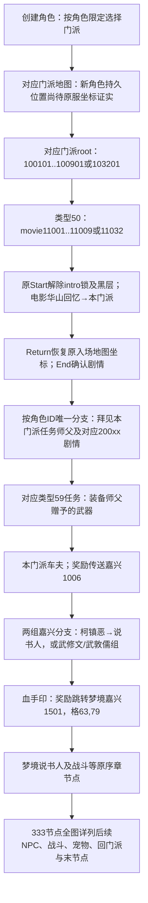

# 新手出生与完整序章证据（本地1.6.1）

本轮research重读原config.pfs，CRC检查后直接BXML解码；将学校、角色限制、主线、NPC和电影脚本联查，按codebase-design分开只读资料与角色/任务/地图状态接入。没有开启客户端、GUI或服务，也没有修改他人的任务、共享入口或玩家存档。

**结论：新手可玩起点是选择门派的门派地图；临安1007是旧实验入口，梦境嘉兴1501是后续剧情地图。10个门派对应10个序章root，不能所有新角色都派100101。精确原服出生坐标仍未从仅客户端文件证实；剧情演员终点单列为设计落点候选。**

已重读5表及10部intro电影；10角色×门派共43个可选组合与首轮主线RequestRoleIDList逐项一致。全序章333节点、366边保存在[全流程图源](NEWBIE_CHAPTER_FLOW.mmd)，每条任务的完整原字段、后继、NPC和源行保存在[原值记录](newbie-origin-client.json)，复现程序为[research_newbie_origin.py](../research_newbie_origin.py)。

## 门派、开场及首NPC对照

表中NPC坐标是cnpcconfig原格坐标；候选落点来自原movie最后一次主角MoveNPC，是电影演员坐标，不能直接声称原服务端出生坐标。对应逻辑像素乘16后，10个候选均通过原生mask1点查询。

| 门派ID | 门派地图 | 序章root / movie | 首轮任务及适用角色 | 首NPC（格坐标） | 电影终点候选（格） |
|---|---|---|---|---|---|
| 11 古墓派 | 1100 古墓派 | 100101 / 11001 | 100184→角色2；100185→角色5；100186→角色9；100187→角色10 | 10014 陆无双 (110,47) | (93,72) |
| 12 丐帮 | 1102 丐帮 | 100201 / 11002 | 100283→角色1；100284→角色3；100285→角色4；100286→角色6；100287→角色7 | 10184 鲁有脚 (35,47) | (51,72) |
| 13 西域密宗 | 1103 西域密宗 | 100301 / 11003 | 100383→角色1；100384→角色3；100385→角色5；100386→角色6；100387→角色7 | 10195 达尔巴 (24,29) | (41,49) |
| 14 白驼山庄 | 1108 白驼山庄 | 100401 / 11004 | 100484→角色3；100485→角色4；100486→角色7；100487→角色8 | 10273 欧阳钧 (155,67) | (138,82) |
| 15 大理段氏 | 1105 大理段氏 | 100501 / 11005 | 100584→角色2；100585→角色4；100586→角色8；100587→角色9 | 10209 朱子柳 (11,35) | (24,50) |
| 16 全真教 | 1101 全真教 | 100601 / 11006 | 100683→角色1；100685→角色5；100686→角色6；100687→角色10 | 10163 丘处机 (26,109) | (37,124) |
| 17 桃花岛 | 1106 桃花岛 | 100701 / 11007 | 100784→角色2；100785→角色5；100786→角色6；100787→角色10 | 10051 程英 (42,73) | (106,106) |
| 18 绝情谷 | 1107 绝情谷 | 100801 / 11008 | 100883→角色1；100885→角色4；100886→角色8；100887→角色9 | 10272 公孙曌 (132,32) | (114,49) |
| 19 百花谷 | 1104 百花谷 | 100901 / 11009 | 100984→角色2；100985→角色3；100986→角色7；100987→角色8 | 10161 瑛姑 (149,60) | (123,96) |
| 111 少林 | 1110 少林 | 103201 / 11032 | 103284→角色4；103285→角色5；103286→角色9；103287→角色10；103283→角色1 | 13291 天鸣禅师 (31,23) | (88,93) |

角色ID名称：1=楚天河；2=秦少游；3=燕重光；4=司马长风；5=杨空岳；6=唐七七；7=独孤月；8=铃小雨；9=云夕；10=韩忆。

## 完整新手主流程

全图是原任务后继图，包含分支与共用节点，不是把所有角色分支依次执行。各门派首轮分支选择后汇合到各自的类型59穿武器节点：100188/288/388/488/588/688/788/888/988/103288。不能用任意NPC交互自动完成这些装备任务。

古墓例：100101→{100184角色2 /100185角色5 /100186角色9 /100187角色10}→100188装备武器→100104古墓车夫10260（原地图1100、NPC格109,79）→100105嘉兴柯镇恶10212→100160说书人10083→100106血手印10498（奖励1501格63,79）→100107战斗AI8001→100179→后续节点。车夫100104奖励原字段是1006格36,221，不是出生原点。

其它门派车夫奖励到嘉兴为格36,221或71,242，两组差异应保留，不统一覆盖。具体id和原RewardMapJumpType见JSON。

## 可直接复核的源行

- 古墓派：cmainmissioninfo.xml:3 root100101；schoolinfo.xml:3；cnpcconfig.xml:151 首NPC；[movie 11001](newbie-source/11001.txt) 第812行Setmap本门派，第830行主角终点。
- 丐帮：cmainmissioninfo.xml:643 root100201；schoolinfo.xml:12；cnpcconfig.xml:1857 首NPC；[movie 11002](newbie-source/11002.txt) 第813行Setmap本门派，第831行主角终点。
- 西域密宗：cmainmissioninfo.xml:1299 root100301；schoolinfo.xml:21；cnpcconfig.xml:1975 首NPC；[movie 11003](newbie-source/11003.txt) 第812行Setmap本门派，第828行主角终点。
- 白驼山庄：cmainmissioninfo.xml:1955 root100401；schoolinfo.xml:30；cnpcconfig.xml:2634 首NPC；[movie 11004](newbie-source/11004.txt) 第813行Setmap本门派，第832行主角终点。
- 大理段氏：cmainmissioninfo.xml:2592 root100501；schoolinfo.xml:39；cnpcconfig.xml:2139 首NPC；[movie 11005](newbie-source/11005.txt) 第813行Setmap本门派，第831行主角终点。
- 全真教：cmainmissioninfo.xml:3229 root100601；schoolinfo.xml:48；cnpcconfig.xml:1614 首NPC；[movie 11006](newbie-source/11006.txt) 第813行Setmap本门派，第831行主角终点。
- 桃花岛：cmainmissioninfo.xml:3872 root100701；schoolinfo.xml:57；cnpcconfig.xml:525 首NPC；[movie 11007](newbie-source/11007.txt) 第813行Setmap本门派，第831行主角终点。
- 绝情谷：cmainmissioninfo.xml:4506 root100801；schoolinfo.xml:66；cnpcconfig.xml:2624 首NPC；[movie 11008](newbie-source/11008.txt) 第813行Setmap本门派，第830行主角终点。
- 百花谷：cmainmissioninfo.xml:5140 root100901；schoolinfo.xml:75；cnpcconfig.xml:1590 首NPC；[movie 11009](newbie-source/11009.txt) 第812行Setmap本门派，第830行主角终点。
- 少林：cmainmissioninfo.xml:16073 root103201；schoolinfo.xml:84；cnpcconfig.xml:23713 首NPC；[movie 11032](newbie-source/11032.txt) 第812行Setmap本门派，第830行主角终点。

XML源目录为revival/decoded/config/autoconfig/；原PFS路径及每个文件SHA256、CRC检查结果在JSON sources。ccreateroleschoolpos里的pos是CEGUI相对/像素混合UI布局（{{0.24,0}..}），不是出生坐标。cmapconfig中的playerPosX/Y和xjPos/yjPos也不能仅凭名字当出生位置。

## 官方端游资料核对

[官方序章缘起（路径日期2012-06-26）](https://sdxl.wanmei.com/info/newplayer/1to9/20120626/131941.shtml)明确0级向各门派任务师父领取，并描述醒来已在门派、领取武器后乘车去嘉兴；[第一次做任务（2012-06-28）](https://sdxl.wanmei.com/info/newplayer/oneminute/20120628/132085.shtml)说明入游戏右侧追踪引导见师父、装备武器、前往嘉兴。它们支持门派新手起点和上述流程（guide_supported），没有给精确出生格坐标。两页历史年代不等于完整匹配本地1.6.1。

[官方创建角色（2012-06-26）](https://sdxl.wanmei.com/info/newplayer/ready/20120626/131970.shtml)说明十大主角、九大门派；本包则有少林111及root103201，因此门派数量及限制采用本包10派，不用旧攻略覆盖。

## 尚需服务器满足的具体条件

1. 创建时按43个合法组合验证角色与门派；新角色初始化门派地图位置，已有账号/存档不强制重置。原坐标缺失时由主策划选择本报告电影终点候选等designed落点并集中登记，不能称原版。
2. 独立持久化新手阶段：intro未启动/播放中/已完成、任务root/分支、奖励幂等键。入服intro判别字段与真实经验分开；0经验合法，不以经验判断要不要重播。
3. 发入服与入图后，在原客户端具备剧情接收条件时启动对应movie。原CStartSetion会解除App+3d8与Scene+39c；Return需恢复角色在电影前的权威原图原点。仅把master场景换为电影Setmap会破坏Return。
4. 类型50需要真实剧情完成事件；按角色ID唯一后继分支。首NPC显示、实体key映射、同图距离校验、对白及branch完成事件均要真实接线。
5. 类型59需要资产所有者给武器并由实际装备事件校验；武器模板与数量不能从创建预览weaponID直接猜成奖励。门派车夫与剧情传送需跨图预留/冻结/切换/清源状态机。
6. 序章后段原战斗AI、宠物获取、回门派技能教学等见全图333节点。表中存在参数只算资料提取，不等于对应Domain或客户端表现已实现。奖励必须角色事务+幂等，进图/剧情恢复与任务阶段不互相覆盖。
7. root以学校+角色配置匹配得出并验证全部组合；客户端原配置未提供“创建成功后服务端自动接哪一root”的服务端程序，本报告不把分配时机称已还原。

本批未接线上述条件，不改任务/账号/网络入口；不会把333个静态任务节点称新手流程已可玩。

## 入服字段纠正

SEnterWorld对象+0x48/+0x4c只称入服intro判别字段；真实XP由packet+0xf8/+0xfc→RoleInfo+0x80→manager+0x178传递。已修正MOVEMENT_INPUT_GATES.md和SCENE_GRID_PROTOCOL.md中的旧“经验0”称呼；开场flag0x2945438=App+0x3d8、原生移动拒绝和Section同步解锁结论保持有效。

验证：5原表及10原movie CRC、BXML完整解码；43角色门派组合与首任务角色表相等；10个本门派Setmap与schoolmapid一致；10个电影终点mask1可走；全序章图JSON/Mermaid生成；无真实客户端实测。

## 机器接线目录

[catalogs/newbie-routes.json](../catalogs/newbie-routes.json) 已按schema1输出43条路由，键为(role_id, school_id)，包含home_map_id、intro_task_id、intro_movie_id、successor_task_id、successor_card_effect_id、first_npc_id，以及cinematic_endpoint的原格/逻辑像素/电影源行。每项都显式server_spawn_confirmed=false。source_status=client_verified指这些客户端原值与角色/门派限制联查，不指原服自动接取时机或出生坐标已确认。

该目录由research_newbie_origin.py从原包重建；43组合唯一性、每派RequestRoleIDList与角色schools完全相等、电影最后Setmap与schoolmapid一致均有断言。未修改设计值文件或已有角色。
